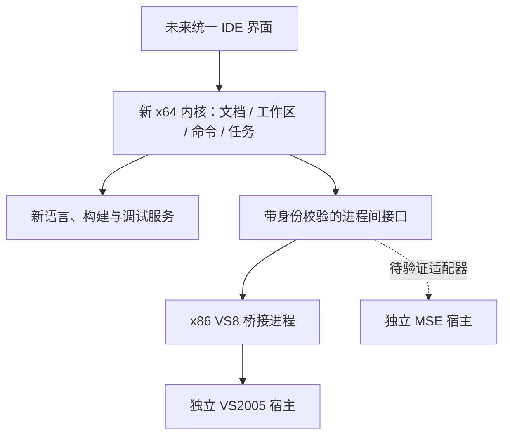

# OpenMSE 内核重写：第一阶段

本阶段交付能力实测、服务契约和兼容桥原型。后续已按整合计划实现阶段 1–5 的 C++ 内核并接入统一界面，见 [core.md](core.md)：文档、设计、项目图、构建/运行任务、旧宿主管理和 CLR 2.0 调试。[统一 GUI](../gui.md) 是独立的 x64 WinForms 进程，只呈现内核状态。根目录 `OpenMSE.exe` 默认打开新 GUI，显式参数保留旧 IDE 启动模式。

## 架构决定

新内核采用 C++17，目标 x64。内核最终拥有文档缓冲区、版本号、工作区、命令路由和任务状态。旧引擎各自在独立 x86 进程运行，通过适配器提供实际验证通过的能力。不得把 VS7 的 MSENV.DLL、VS8 的 msenv.dll 和它们的包加载到同一个新内核进程。

目前 `src/bridge/HostBridge.cs` 实现 JSONL/stdio → EnvDTE 的实验路径。桥进程用 CLR4，目标 VS2005 保留原运行环境；它们通过进程间 COM 通信。桥不是生产级服务，也没有窗口嵌入方案。

## 服务契约

`include/openmse/kernel/services.hpp` 定义文档、工作区、语言、命令路由、构建、调试、事件、能力和宿主传输接口。没有 HWND、COM 或 CLR 类型泄漏到内核契约。文本与协议字符串采用 UTF-8；源码位置采用从零开始的行号和 UTF-16 列号。跨文件定义位置包含 URI。

文档修改要求预期版本号，保存返回已落盘版本。异步请求携带关联 ID、截止时间和取消标记。能力需要记录证据等级、来源和限制，不能以“命令存在”推断“功能可用”。这些是待实现的要求，当前桥接仅用完整旧文本校验，尚无内核版本控制、事件流或取消实现。

构建结果分别表示失败项目数、编译错误数和警告数。EnvDTE 的 `LastBuildInfo` 仅提供失败项目数；不能把它当作错误数量或进程退出码。

## 已知依赖与边界

本机移植版仍依赖原安装中的 .NET、GAC、COM、许可和部分 Business Objects 共享组件。迁移目录内的运行成功不证明干净机器可用。微软运行组件不属于新内核源码，也不能据此视作可自由发布的实现。

MSE 未通过当前 ROT 和顶层窗口 NativeOM 探测，不能把 VS8 DTE 当作两套引擎共有的基础。下一步优先让新内核独立拥有文本文档；MSE 专有服务适配需单独验证。不得通过猜测内部偏移调用函数。

VS8 的设计器窗口嵌入、旧插件迁移、语言补全和脚本调试均未验证。实测调试启动失败，详见能力矩阵。

## 后续里程碑与验收

1. 内核最小实现：独立的文档/工作区服务、版本冲突检测、UTF-8 与中文保存、明确的脏文档关闭策略。先用命令行宿主验证，不依赖任何旧 IDE。
2. 接入 VS8 已验证能力：引入宿主管理、握手版本、请求超时、异步任务和断连恢复；避免内核与旧 IDE 同时成为同一文档的权威。重启适配器后不得重复写入或误关用户进程。
3. 调试与 MSE 专项：定位本机 `debug.start` 的 E_FAIL，取得断点、单步、变量与调用栈的实测证据；另行确定 MSE 可支持的服务接口。未通过前界面显示为不可用。
4. 统一界面：在上述服务稳定后实现命令、项目树、编辑器和调试面板，再讨论设计器兼容。验收以一个工作区内完成编辑、构建、调试为准。

参考：[EnvDTE Debugger](https://learn.microsoft.com/en-us/dotnet/api/envdte.debugger?view=visualstudiosdk-2022)。实际编译与实测使用本机 EnvDTE 8.0，而非假定新版 SDK 的所有能力均存在。
