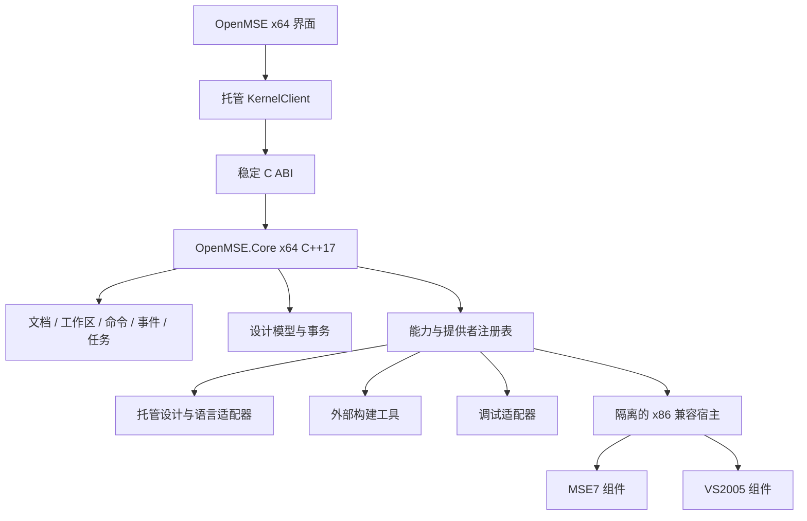

# OpenMSE 架构整合计划

状态：阶段 1–6 已实现，见 [core.md](core.md) 和 [打包与安装检查](../packaging.md)。VS2005 调试与 MSE 自动化经实测仍为阻塞，调试改由新的 CLR 2.0 适配器提供。基于当前源码、已通过的 GUI/设计器测试及旧引擎桥接实测制定。

## 目标与当前事实

目标是由 OpenMSE 管理同一个工作区、文档状态、设计事务、命令和任务，再向不同语言、设计器、构建和调试后端分发操作。旧引擎进程隔离继续保留，核心能力逐步迁入新实现。

目前的实现包含两条路径：

1. x64 WinForms 新界面自行实现文本编辑、静态布局、工具箱和导出，直接管理文件，并调用系统 .NET 2.0 MSBuild。
2. x86 启动器加 Detours 重定向层运行原版 MSE7 / VS2005。独立的 EnvDTE 桥已验证 VS8 文档与构建能力，但没有接入新界面。MSE 的 ROT/NativeOM 接入和 VS8 调试启动仍有阻塞。

`services.hpp` 只是 C++ 服务契约。尚不存在统一的文档内核、设计事务系统或生产级宿主管理器。`OFFICE12`、`VS7Debug`、`VS8` 是原组件依赖边界，不等于三个已整合的内核模块。

## 目标结构

原生内核不依赖窗口控件，不加载旧 MSENV、Office 或 CLR 类型。托管控件创建和 UI 呈现留在托管适配器。旧引擎按需在独立 x86 进程启动，不进入 x64 内核地址空间。

保留现有 WinForms 界面，以减少重复重写。新 C++ 内核以 x64 DLL 提供服务；当前 C++ 接口中的 STL、future 和异常只在 C++ 内部使用，不直接交给 C#。跨边界采用不透明句柄、带长度 UTF-8 数据和明确的结果缓冲区所有权。

建议 ABI 操作包括创建/销毁内核、提交请求、读取结果/事件、取消请求及释放结果缓冲区。需要版本握手和异常转换；UI 通过调度器消费事件，不从原生工作线程直接操作控件。第一条链路只实现文档和保存，验证完成后再扩大 ABI。

## 模块归属

| 模块 | 权威状态与职责 | 当前代码的迁移方向 |
|---|---|---|
| DocumentService | 文档 ID、缓冲区、版本、编码、换行、脏状态、保存冲突、撤销历史 | 从 `EditorDocument` 与 `EditorPage` 提取；RichTextBox 成为视图 |
| WorkspaceService | 工作区、真实项目图、文件 URI、配置与启动项目 | 从目录树与 solution 字符串迁出，逐步解析 sln/csproj/vbproj |
| CommandRouter | 命令 ID、上下文、可用状态、执行结果 | 菜单和工具栏绑定相同命令，停止各自直接启动进程或写文件 |
| DesignService | 设计节点、布局事务、属性变更、源码补丁、设计版本 | 从 `DesignerView`、`HtmlLayout`、`FormLayout` 提取模型操作 |
| ToolboxService | 稳定控件 ID、分类、图标、属性描述、可用能力、创建后端 | 现有 17+22 条目成为提供者描述，不与 ListBox 事件绑定 |
| BuildService | 构建配置、输入快照、任务状态、日志、退出码、产物 | 从 `MainForm.StartBuild` 提取，封装外部工具发现和运行 |
| DebugService | 调试会话、状态机、断点、源码映射、变量和调用栈 | 先解决实测阻塞，后接统一 UI；不能仅因接口存在就启用 |
| HostManager | 宿主身份、位数、能力、启动/退出、心跳、超时与断连恢复 | 统一原 launcher 和 HostBridge 的生命周期管理 |
| EventService | 有序事件、关联 ID、文档版本和任务状态通知 | 更新现有只声明 publish 的契约，补齐订阅与生命周期规则 |

图标和控件呈现仍由界面/托管适配器负责。内核的能力声明使用稳定 ID，不携带 System.Drawing.Bitmap、HWND、COM 指针或托管控件实例。

## 最重要的数据约束

### 一个文档只有一个权威缓冲区

内核保存文档内容和版本；源码编辑器、设计视图、属性面板及旧引擎只消费快照并提交修改。每次写入携带 expectedRevision，过期操作返回 conflict 并刷新快照。

内核文本使用规范化 LF 与 UTF-8，磁盘编码和换行策略独立保存。界面位置采用零基行号和 UTF-16 列号，适配器负责与 UTF-8、RichTextBox 和 DTE 一基坐标转换。必须覆盖中文、代理对、换行和文本范围边界测试。

保存入口全部通过内核；保存前检测外部文件变更，成功后记录 persistedRevision。工作区按规范化 URI 与文件身份去重。只关闭已保存或已明确选择丢弃的文档，不能用宿主退出代替文档关闭策略。

### 设计和源码共用事务及撤销历史

设计操作表示为 AddNode、MoveNode、ResizeNode、SetProperty、DeleteNode 等命令，携带文档版本和节点 ID。DesignService 生成源码补丁，经 DocumentService 原子提交，再广播新版本。

拖动期间的位置预览只发生在 UI；松开时提交一笔事务。属性编辑和源码编辑使用同一份撤销/重做历史。切换设计/源码视图不能修改文件，也不能各自维护一份互不相认的保存状态。

HTML 保留未识别标签、脚本、注释和属性；不能通过重建整页丢失用户代码。当前扫描器需要迁入独立适配器并逐步加强。现有静态布局视图继续明确为基础能力，完整 HTML 渲染和旧 MSE 设计器兼容单独验收。

`.omform` 继续保持版本化格式。后续增加容器父子关系、资源和事件引用；新增能力需要格式迁移，旧文件必须可读。用户事件代码与生成代码分离，不能通过重新导出覆盖用户逻辑。

### 长任务具有独立身份

构建和调试请求返回 task/session ID，UI 订阅状态。构建统一保存策略、配置和工作目录，记录真实退出码及产物。DTE LastBuildInfo 始终仅表示失败项目数。

调试状态至少包含 idle、starting、running、stopped、terminating、exited、failed。只有 stopped 状态允许单步和求值；只有具备行为证据的后端显示为可用。

## 兼容层与组件管理

新增宿主清单，记录 engine ID、位数、入口、工作目录、依赖根、配置命名空间、文件版本/哈希和能力。清单替代散落在 launcher/hook 中的硬编码路径。旧路径在迁移期保留映射，避免破坏已有安装和正在进行的上传。

x64 主入口负责统一 UI 和内核。旧 Detours 逻辑保留在独立 x86 启动助手中；再按能力启动 MSE 或 VS8。x64 GUI 不直接调用 x86 DLL。

现有 JSONL 桥升级前需要明确：协议版本、消息大小、请求 ID、事件序号、进程创建时间校验、超时、断连和取消语义。COM 请求超时不代表操作未执行，重连后必须核对宿主和文档状态，不能盲目重放写入。

新核心是文档权威后，旧编辑器只处理工作副本或明确交接的文档。生产整合前必须选定每种提供者的同步模式，禁止两个编辑器同时自动覆盖同一文件。

MSE 没有已验证的 DTE 接口，应继续分析其公开 COM/服务接口或改用独立实现。VS8 的调试 E_FAIL 需要专项检查启动项目、目标位数、CLR2 调试组件及符号映射；这些是待排查项，不能当作已确定原因。

运行目录已按用户要求先合并为统一 `runtime/`。后续以“启动、打开文件、构建、调试、设计器”等实际场景测出依赖闭包，形成最小兼容包和可选扩展包。目录整形最后进行，不通过搬动同名 DLL 假装功能合并。

## 迁移顺序与验收

| 阶段 | 交付 | 验收条件 |
|---|---|---|
| 1. 接通内核 | Core DLL、稳定 ABI、KernelClient、文档与命令最小实现 | UI 经内核打开/修改/撤销/保存，脏状态和版本一致；测试目录无旧 runtime 也能完成 |
| 2. 整合设计 | ToolboxService、统一设计节点与文档事务 | 拖放→属性修改→源码同步→撤销→保存→重开不丢数据；HTML/窗体各自完成一条闭环 |
| 3. 整合项目与构建 | 项目图、工具发现、异步任务和产物模型 | C#/VB 项目从新界面完成构建与运行；多项目配置、失败与取消可辨认 |
| 4. 稳定兼容后端 | 宿主清单、生命周期和升级后的桥协议 | 只操作自有实例；超时与宿主重启不重复写入、不丢文档、不冻结 UI |
| 5. 接入语言与调试 | 能力驱动的语言/调试适配器 | 断点命中、单步、变量、调用栈和源码定位均有实际证据；MSE 能力独立验收 |
| 6. 打包与精简 | 核心包、可选兼容包、依赖清单和安装检查 | 核心包不需整套 VS8；每个可选包有明确场景和验证结果 |

阶段 1 的纵向链路 `文件 → 新建/打开 → KernelClient → DocumentService → 编辑 → 保存 → 状态回传` 已完成（2026-11-20）。ABI 目前是同步调用，尚未实现取消和截止时间。

阶段 2 已完成（2026-11-20）：ToolboxService 提供稳定条目 ID，DesignService 把 add/set/delete/set_form 操作转为源码补丁，经 DocumentService 原子提交。HTML 与窗体各自通过了拖放到重开的闭环。阶段 3–5 已完成（2026-11-20）：
- 阶段 3：项目图、工具发现、异步构建/运行任务，结束状态分为成功、失败、取消。
- 阶段 4：宿主清单与版本/哈希核对；HostManager 只绑定自有实例；桥协议 v2 处理超时核对、队列过期不执行、断开重连和重启，内容幂等的同步不会重复写入。
- 阶段 5：VS2005 `Debugger.Go` 复测仍为 E_FAIL，因此调试由新的 OpenMSE.DebugHost（ICorDebug v2，x86/x64）提供，断点、单步、变量、调用堆栈和源码位置都有测试证据；MSE 独立验收的结果是自动化不可达。

阶段 6 已完成（2026-11-20）：按实际场景追踪旧进程的文件访问，并补充静态导入分析，测出依赖闭包，形成 `core`（约 1 MiB，不含任何旧运行组件）、`vs8-backend`（46 个运行文件）、`mse-window`（32 个运行文件）和 `legacy-full` 四个包。每个包都在新目录中组装，并通过了它声明的场景。`scripts/check-install.ps1` 负责安装检查。详见 [docs/packaging.md](../packaging.md)。
